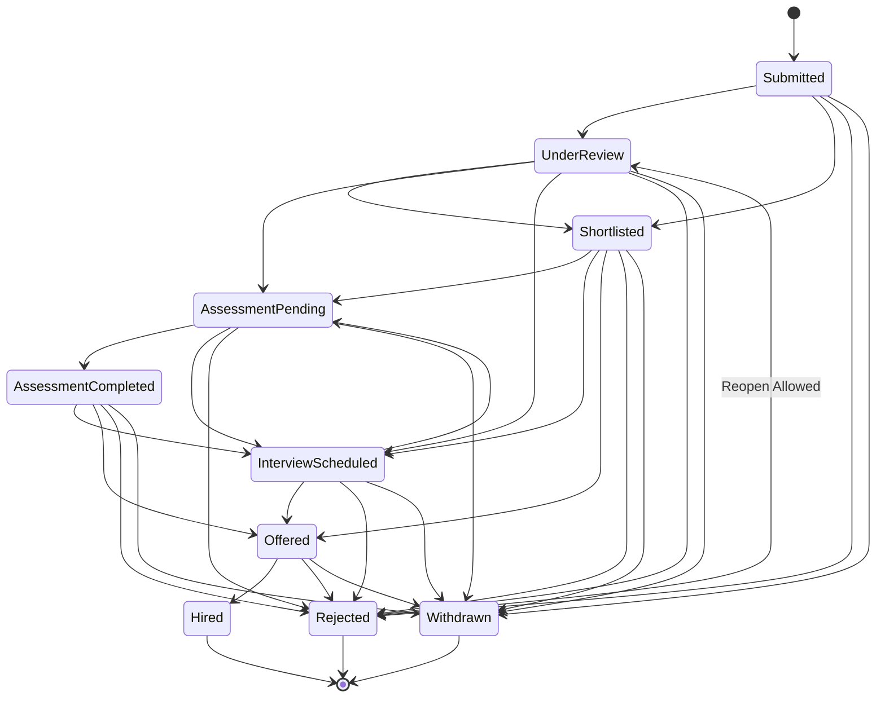

# HireSphere — Company Recruitment Workspace, Candidate Review & Recruitment Pipeline Specification

**Document ID:** `HS-SPEC-11`  
**Version:** 1.0  
**Phase:** Prompt 11 Implementation Protocol  
**Theme:** Crisp White & Light-Blue Corporate Aesthetics  
**Status:** Implemented & Verified  

---

## 1. Executive Summary & Architectural Scope

Prompt 11 transforms the HireSphere company portal into an end-to-end recruitment workspace. Employers, hiring managers, and recruiters can now manage their entire hiring funnel from a single centralized hub—from viewing incoming candidate applications to evaluating explainable CV match reports, reviewing WorkSim simulation scorecards, coordinating multi-stage interviews, exchanging private recruiter notes, and advancing candidates through an audited recruitment pipeline.

### Core Architectural Principles
1. **Multi-Tenant Data Isolation:** Every workspace query, pipeline card, application detail, interview schedule, and recruiter note is strictly scoped by the authenticated user's `CompanyId`. Company users cannot inspect, query, or mutate recruitment assets belonging to any other company.
2. **Strict SQL Server Management:** Zero automated schema alterations or EF Core migration executions (`Database.Migrate()` / `Database.EnsureCreated()` forbidden). All tables and constraints utilize manual, idempotent scripts in `database/scripts/`.
3. **Rigid State Machine:** Candidate stage progressions are governed by deterministic backend transition rules with audit logging into `dbo.ApplicationStatusHistories`. Terminal states (`Hired`, `Withdrawn`) are enforced, and consequential transitions (`Hired`, `Rejected`) require explicit user confirmation.
4. **Data Privacy for Recruiter Notes:** Internal recruiter notes in `dbo.CandidateNotes` are visible only to authorized company teammates (`Owner`, `Recruiter`, `HiringManager`). They are structurally excluded from candidate API endpoints.
5. **Harmonious White & Light-Blue Design System:** Consistent typography, light-blue accent gradients, subtle borders (`var(--border-color)`), soft-yellow highlight badges for pending actions, and accessible interactive states across desktop and responsive viewports.

---

## 2. Company Recruitment Workspace (`/company/dashboard`)

The enhanced company dashboard provides an operational cockpit for the employer's recruitment team.

### Workspace Metrics Ribbon
* **Active Vacancies:** Live, published job openings accepting applications. Links directly to `/company/jobs`.
* **Applications Requiring Review:** Candidates in initial `Submitted` or `UnderReview` stages awaiting recruiter assessment.
* **Shortlisted Candidates:** High-potential candidates advanced to the `Shortlisted` stage.
* **Upcoming Interviews:** Confirmed interviews scheduled for the company across the upcoming calendar horizon.
* **Pending WorkSim Evaluations:** Active simulation assignments awaiting candidate completion or human review.

### Recruitment Tasks & Action Items
An intelligent alert panel that dynamically surfaces immediate operational needs:
* Unreviewed applications submitted within the past 48 hours.
* Interrupted or expired WorkSim assessments requiring employer review.
* Scheduled interviews occurring within the next 24 hours.

### Upcoming Interviews Agenda
A structured timeline displaying:
* Candidate name, target position, and interview type (`Screening`, `Technical`, `Cultural`, `Final`).
* Start time and duration (converted from UTC to the recruiter's local time).
* Meeting location, room, or secure videoconference link.
* One-click navigation to open the full candidate application review modal.

### Active Vacancies Overview & Activity Stream
* Direct summary of all active job postings with application counts.
* Chronological activity feed showing recent application submissions with candidate name, headline, and submission timestamp.

### Team Collaboration & Membership Management
* In-line overview of authorized company members and their role assignments (`Owner`, `Recruiter`, `HiringManager`).
* Team invitation modal with role delegation, secured by role-based backend authorization.

---

## 3. Centralized Application Management (`/company/applications`)

### Server-Side Filtering & Search
* **Full-Text Candidate Search:** Performs server-side search across candidate `FirstName`, `LastName`, `Email`, and professional `Headline`.
* **Job Filter:** Dropdown populated from company jobs, allowing recruiters to isolate candidates for a single vacancy or view company-wide pipeline activity.
* **Recruitment Stage Filter:** Filter by specific application stages or view all active stages.
* **Sorting & Pagination:** Server-side sorting by application date (`desc`/`asc`), candidate name, or match rating with configurable page sizes (default: 15 per page).

### Dual Workspace View Modes
Recruiters can toggle seamlessly between two representations of their pipeline:
1. **Recruitment Pipeline Board (Kanban):** Visual multi-column board grouping applications across all 9 pipeline stages.
2. **Data Table View:** High-density, paginated table with candidate summary, applied role, date, CV Match score badge, WorkSim score badge, and quick action buttons.

---

## 4. Visual Recruitment Pipeline Board (Kanban)

The pipeline board categorizes applications across 9 standard recruitment stages:

| Stage Index | Stage Identifier | Stage Label | Column Accent |
| :---: | :--- | :--- | :--- |
| `0` | `Submitted` | Submitted | Light Slate Blue |
| `1` | `UnderReview` | Under Review | Royal Blue |
| `2` | `Shortlisted` | Shortlisted | Emerald / Teal |
| `3` | `AssessmentPending` | WorkSim Assigned | Amber / Soft Yellow |
| `4` | `AssessmentCompleted` | WorkSim Completed | Indigo Blue |
| `5` | `InterviewScheduled` | Interview Scheduled | Violet / Purple |
| `6` | `Offered` | Offer Extended | Golden Amber |
| `7` | `Hired` | Hired (Terminal) | Vibrant Green |
| `8` | `Rejected` | Rejected | Crimson Red |

### Pipeline Board Cards
Each candidate card displays:
* Candidate name and applied job title.
* Submission date badge.
* **CV Match Indicator:** Shows AI match evidence percentage (e.g. `85% Match`) when an evaluated CV match report exists.
* **WorkSim Score Indicator:** Displays validated simulation score (e.g. `92/100`) when a simulation has been completed.
* **Quick Advance Actions:** Stage progression buttons allowing recruiters to advance candidates directly to the next logical stage without leaving the board.
* Clickable card area that opens the full Candidate Review Modal.

---

## 5. Candidate Review Workspace (Application Details)

When a recruiter selects a candidate from the table or board, an interactive, tabbed Candidate Review Modal opens:

### Tab 1: Profile & CV
* Comprehensive candidate background: full name, email, phone number, location, portfolio/LinkedIn URLs, headline, and bio summary.
* Candidate cover note submitted with the application.
* Associated CV document details with download action and extraction status badge.

### Tab 2: Explainable CV-to-Job Match Report
* Powered by HireSphere's document matching engine.
* Overall Match Index percentage and evidence synthesis.
* Itemized requirement evaluations categorizing qualifications into `Exceeds`, `Meets`, `PartiallyMeets`, or `Unmet` with source citation quotes.

### Tab 3: WorkSim Assessment Scorecard
* Simulation scenario title and version metadata.
* Real-time assignment status (`Invited`, `InProgress`, `Completed`, `Expired`, `Cancelled`).
* Validated total score and percentage.
* Rubric-based breakdown showing individual criterion points, candidate performance tier, and factual evidence logs.

### Tab 4: Interview Coordination
* List of all interviews associated with this application, categorized as `Upcoming`, `Completed`, or `Canceled`.
* **Schedule Interview Form:**
  * Interview type: `Screening`, `Technical`, `Cultural`, `Final`.
  * Start and end date/time picker (validated so end time is strictly after start time).
  * Meeting location / online conference details.
* **Reschedule / Cancellation Modal:** Captures cancellation or rescheduling details and notifies the candidate.

### Tab 5: Private Recruiter Notes
* Internal collaboration stream visible exclusively to authenticated company team members.
* Displays author name, timestamp, and formatted note content.
* Ability for recruiters to add new notes and delete their own notes (or company owners to manage all notes).
* **Guaranteed candidate privacy:** Notes are strictly stored in `dbo.CandidateNotes` and omitted from candidate responses.

### Tab 6: Recruitment Decision & State Machine Transitions
* Form to update the application's current recruitment stage.
* Optional decision note recorded permanently in `dbo.ApplicationStatusHistories`.
* **Consequential Decision Confirmation Modal:** Selecting `Hired` or `Rejected` prompts a high-importance confirmation modal preventing accidental irreversible decisions.

---

## 6. Recruitment Pipeline State Machine & Validation Rules

Application stage progression is governed by `ApplicationService.ValidateStageTransition`:

### Business Rules Enforced
1. **Terminal States:** `Hired` and `Withdrawn` are terminal stages. Once reached, applications cannot be transitioned to any other stage.
2. **Reopening Rejected Candidates:** An employer may reopen a `Rejected` candidate back to `UnderReview` if additional vacancies arise or upon appeal.
3. **Candidate Withdrawal Protection:** Company recruiters cannot transition an application to `Withdrawn`. Only candidates can withdraw their own applications.
4. **Audit Trail:** Every stage change creates an immutable row in `dbo.ApplicationStatusHistories` storing `PreviousStage`, `NewStage`, `ChangedByUserId`, `ReasonNote`, and `CreatedAtUtc`.
5. **Notification Dispatch:** Transitions trigger candidate in-app notifications and email dispatch records (`dbo.Notifications` and `dbo.EmailDeliveryAttempts`).

---

## 7. Interview Coordination Workflow

### Data Model
Mapped to `dbo.InterviewSchedules`:
* `Id` (`UNIQUEIDENTIFIER`): Primary key.
* `CompanyId` (`UNIQUEIDENTIFIER`): Tenant company foreign key.
* `JobApplicationId` (`UNIQUEIDENTIFIER`): Associated application foreign key.
* `InterviewType` (`INT`): `0: Screening`, `1: Technical`, `2: Cultural`, `3: Final`.
* `ScheduledStartUtc` (`DATETIMEOFFSET`): Start timestamp in UTC.
* `ScheduledEndUtc` (`DATETIMEOFFSET`): End timestamp in UTC.
* `MeetingLocation` (`NVARCHAR(500)`): Room name, physical address, or virtual URL.
* `Status` (`INT`): `0: Scheduled`, `1: Completed`, `2: Rescheduled`, `3: Canceled`.
* `CreatedAtUtc`, `UpdatedAtUtc`: Audit timestamps.

### Workflow Rules
1. **Ownership Enforcement:** An interview can only be created or modified if the associated job application belongs to the user's active company.
2. **Chronological Validity:** Start time must precede end time; start time cannot be placed in the distant past.
3. **Candidate Notification:** When an interview is scheduled or cancelled, an in-app notification is immediately generated for the candidate with details on the meeting time and format.

---

## 8. Backend API Endpoints & Contracts

### Company Workspace & Interviews (`CompanyController`)
* `GET /api/companies/{companyId}/workspace-dashboard`
  * Returns: `CompanyWorkspaceDashboardDto` (metrics ribbon, pending tasks, upcoming interviews, active vacancies, recent applications).
* `GET /api/companies/{companyId}/interviews?upcomingOnly={bool}&limit={int}`
  * Returns: `List<InterviewScheduleDto>` scoped to the company.

### Company Applications & Pipeline (`CompanyApplicationsController`)
* `GET /api/company-applications?jobId={uuid}&stage={int}&search={string}&sortBy={string}&sortDescending={bool}&page={int}&pageSize={int}`
  * Server-side paginated candidate list with search across name, email, and headline.
* `GET /api/company-applications/board?jobId={uuid}`
  * Returns: `PipelineBoardDto` with 9 columns and itemized candidate cards.
* `GET /api/company-applications/{id}`
  * Returns: Detailed application record including candidate profile, CV match summary, WorkSim results, interview history, and recruiter notes.
* `PUT /api/company-applications/{id}/stage`
  * Body: `{ newStage: int, reasonNote: string }`
  * Validates state machine rules, records status history, dispatches notifications.
* `GET /api/company-applications/{id}/notes`
  * Returns: `List<CandidateNoteDto>` for authorized company members.
* `POST /api/company-applications/{id}/notes`
  * Body: `{ noteText: string }`
  * Adds a private recruiter note authored by the authenticated user.
* `DELETE /api/company-applications/{id}/notes/{noteId}`
  * Deletes a recruiter note (author or company owner only).
* `GET /api/company-applications/{id}/interviews`
  * Returns: `List<InterviewScheduleDto>` for this application.
* `POST /api/company-applications/{id}/interviews`
  * Body: `{ interviewType: int, scheduledStartUtc: string, scheduledEndUtc: string, meetingLocation: string }`
  * Schedules an interview and notifies the candidate.
* `PUT /api/company-applications/{id}/interviews/{interviewId}`
  * Updates or reschedules an interview.
* `POST /api/company-applications/{id}/interviews/{interviewId}/cancel`
  * Cancels the interview and emits a notification to the candidate.

---

## 9. Database Scripts & Verification

### Script 12: `012_EnsureRecruiterNotesAndInterviewSchedules.sql`
* **Purpose:** Idempotent schema verification ensuring `dbo.CandidateNotes` and `dbo.InterviewSchedules` tables, foreign keys, and performance indexes exist.
* **Execution Mode:** Manual execution in SQL Server Management Studio (SSMS).
* **Index Coverage:**
  * `IX_CandidateNotes_JobApplicationId` (Fast note retrieval by application)
  * `IX_CandidateNotes_CompanyId_CreatedAtUtc` (Company notes audit)
  * `IX_InterviewSchedules_CompanyId_ScheduledStartUtc` (Fast upcoming interview lookups)
  * `IX_InterviewSchedules_JobApplicationId` (Application interview history)

---

## 10. Automated Test Results

### Backend xUnit Test Suite (`HireSphere.Tests.Unit`)
* **Test File:** `backend/tests/HireSphere.Tests.Unit/CompanyWorkspaceTests.cs`
* **Coverage:**
  * Stage transition state machine validation (valid progressions, illegal terminal modifications, candidate withdrawal restrictions).
  * Server-side candidate search across first name, last name, and headline.
  * Company workspace dashboard metric aggregations and task generation.
  * Pipeline board column grouping across all 9 stages.
  * Interview scheduling, time validation, and cancellation.
  * Recruiter note creation, authorization, and author-based deletion rules.
  * Multi-tenant application isolation between separate companies.
* **Result:** `Passed! Failed: 0, Passed: 119, Skipped: 0, Duration: 3 s`.

### Frontend Build & Static Analysis (`frontend/`)
* **TypeScript Compilation (`tsc -b`):** 0 errors.
* **Vite Production Bundling:** 2,399 modules transformed and bundled into `dist/`.
* **Linter (`oxlint`):** 0 errors.
