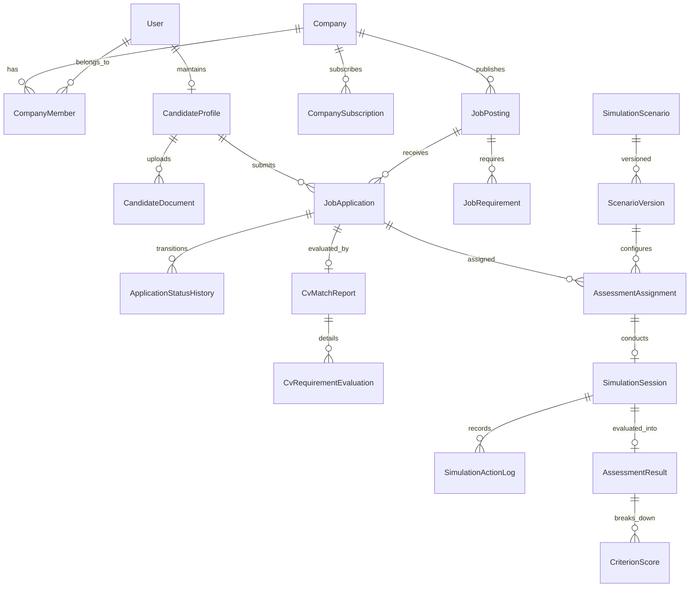

# HireSphere — Domain Model & Database Design Specification

**Document ID:** `HS-DAT-03`  
**Version:** 1.0  
**Status:** Approved for Phase 1 Schema Formulation  

---

## 1. Domain Entity Inventory by Bounded Context

The HireSphere domain is partitioned into six bounded contexts. Below is the comprehensive entity inventory with primary responsibilities.

```
┌────────────────────────────────────────────────────────────────────────────────────────┐
│                                   HIRESPHERE DOMAIN                                    │
├─────────────────────┬──────────────────────┬────────────────────┬──────────────────────┤
│ 1. Identity & Tenant│ 2. Job Marketplace   │ 3. Applications    │ 4. WorkSim Engine    │
│  • User             │  • JobPosting        │  • JobApplication  │  • SimulationScenario│
│  • Role             │  • JobRequirement    │  • AppStatusHistory│  • ScenarioVersion   │
│  • UserRole         │  • JobCategory       │  • CandidateNote   │  • AssessmentAssign  │
│  • Company          │                      │  • ScorecardReview │  • SimulationSession │
│  • CompanyMember    ├──────────────────────┼────────────────────┤  • SimActionLog      │
│  • CompanyInvite    │ 5. CV & Matching     │ 6. SaaS & Auditing │  • AssessmentResult  │
│  • RefreshToken     │  • CandidateDocument │  • SubscriptionPlan│  • CriterionScore    │
│                     │  • DocExtractionJob  │  • CompanySubscript│                      │
│                     │  • CvMatchReport     │  • UsageRecord     ├──────────────────────┤
│                     │  • CvRequirementEval │  • AuditLog        │ 7. Notifications     │
│                     │                      │                    │  • Notification      │
└─────────────────────┴──────────────────────┴────────────────────┴──────────────────────┘
```

---

### Context 1: Identity, Users & Multi-Tenant Organizations
1. **`User`**: Core identity entity. Stores email, hashed password, security stamp, phone number, account status (`Active`, `Disabled`, `PendingVerification`), and timestamp metadata.
2. **`Role`**: Platform-level roles (`Candidate`, `CompanyMember`, `SuperAdmin`).
3. **`UserRole`**: Many-to-many relationship linking `User` and `Role`.
4. **`Company`**: Tenant organization entity. Stores company name, business registration number, logo URL, website, industry, verification status (`PendingApproval`, `Approved`, `Rejected`, `Suspended`), rejection reason, and timestamps.
5. **`CompanyMember`**: Scoped membership entity linking a `User` to a `Company`. Contains tenant-specific role (`Owner`, `Recruiter`, `HiringManager`), joined date, and status.
6. **`CompanyInvitation`**: Invitation token issued to prospective team members with designated role, expiration timestamp, and acceptance status.
7. **`RefreshToken`**: Cryptographic refresh token associated with a user device session for secure JWT renewal.

---

### Context 2: Job Marketplace & Vacancy Management
8. **`JobCategory`**: Reference category classification (e.g., Software Engineering, Finance, Operations, Sales).
9. **`JobPosting`**: Vacancy entity owned by a `Company`. Stores title, slug, summary, detailed description, employment type (`FullTime`, `PartTime`, `Contract`, `Internship`), workplace type (`Remote`, `Hybrid`, `OnSite`), location, currency, salary min/max, status (`Draft`, `Published`, `Paused`, `Closed`, `Archived`), published timestamp, and version number.
10. **`JobRequirement`**: Structured qualification criteria attached to a `JobPosting`. Stores requirement description, category (`Skill`, `Experience`, `Education`, `Certification`), requirement type (`Mandatory`, `Preferred`), and weight.

---

### Context 3: Candidate Profiles & Applications
11. **`CandidateProfile`**: Extended candidate entity linked 1-to-1 with a `User`. Stores headline, bio summary, location, years of experience, LinkedIn URL, GitHub URL, and portfolio link.
12. **`CandidateDocument`**: Candidate's uploaded CV file. Stores original filename, sanitized storage key (GUID), file path, MIME type, file byte size, upload date, and active/default flag.
13. **`JobApplication`**: Application submission linking a `CandidateProfile` to a `JobPosting`.
    * **Historical Immutability:** Stores foreign key to the applied `CandidateDocument` version and a frozen JSON snapshot of the `JobPosting` and `JobRequirements` at the exact moment of submission.
    * Tracks current stage (`Submitted`, `UnderReview`, `Shortlisted`, `AssessmentPending`, `AssessmentCompleted`, `InterviewScheduled`, `Offered`, `Hired`, `Rejected`, `Withdrawn`).
14. **`ApplicationStatusHistory`**: Immutable audit log of application lifecycle transitions. Stores `PreviousStatus`, `NewStatus`, `ChangedByUserId`, `TimestampUtc`, and `Note`.
15. **`CandidateNote`**: Internal collaborative notes left by company recruiters/hiring managers on an application.
16. **`ScorecardReview`**: Structured interview evaluation submitted by hiring managers against defined evaluation criteria.

---

### Context 4: CV Processing & Requirement Matching
17. **`DocumentExtractionJob`**: Background parsing record for a `CandidateDocument`. Stores extraction status (`Pending`, `Processing`, `Success`, `Failed`, `ScannedPdfDetected`), extracted raw text, parser version, and error message.
18. **`CvMatchReport`**: Algorithmic match report comparing an application's CV text against the job requirements. Stores overall match index, calculation version timestamp, and reviewer acknowledgment status.
19. **`CvRequirementEvaluation`**: Itemized match record for each job requirement. Stores requirement reference, status (`SupportedByEvidence`, `PartiallySupported`, `NotFound`, `RequiresManualReview`), confidence score, and extracted evidence text snippet from the CV.

---

### Context 5: WorkSim Assessment Engine
20. **`SimulationScenario`**: Assessment template (e.g., "Software Engineering: Checkout Outage"). Stores title, industry, description, estimated duration minutes, and active flag.
21. **`ScenarioVersion`**: Versioned definition of a simulation scenario. Stores state machine configuration, allowed actions catalog, asset references, and rubric definition in a structured JSON payload.
22. **`AssessmentAssignment`**: Assignment of a scenario to a `JobApplication` (or candidate). Stores deadline, required/optional flag, and status (`Assigned`, `InProgress`, `Completed`, `Expired`).
23. **`SimulationSession`**: Active interactive assessment session instance. Stores candidate ID, scenario version ID, session state vector (JSON), start time, expiration time, submitted time, and completion status.
24. **`SimulationActionLog`**: Append-only event stream recording every candidate action. Stores action type, action payload, timestamp, elapsed milliseconds from session start, and resulting state transition.
25. **`AssessmentResult`**: Server-calculated outcome record. Stores overall score, rubric version evaluated, evaluation summary, candidate-facing feedback, and company-facing report.
26. **`CriterionScore`**: Itemized breakdown for a competency criterion (e.g., "Investigation Quality: 85/100", with linked evidence logs).

---

### Context 6: Subscriptions, Usage & Auditing
27. **`SubscriptionPlan`**: Configurable SaaS plan (e.g., `Starter`, `Growth`, `Enterprise`). Defines monthly limits: max active jobs, team member seats, monthly CV parses, and assessment tokens.
28. **`CompanySubscription`**: Active plan attached to a `Company`. Stores plan ID, status (`Active`, `PastDue`, `Canceled`), current billing period start/end.
29. **`TenantUsageRecord`**: Monthly usage tracking entity for a company. Records current period counts for active jobs, member seats, CV extraction operations, and completed assessments.
30. **`Notification`**: Notification message delivered to a user (`ApplicationStatusUpdated`, `AssessmentAssigned`, `CompanyApproved`), with read/unread flag and action link.
31. **`AuditLog`**: Centralized security and compliance log tracking actor, action, tenant, target resource, timestamp, and metadata.

---

## 2. Entity Relationship Overview (Mermaid)



---

## 3. Database Constraints, Keys & Indexing Strategy

### 3.1 Keying Conventions
* **Primary Keys:** `Id UNIQUEIDENTIFIER NOT NULL DEFAULT NEWSEQUENTIALID()` used across domain entities to support high-throughput, non-fragmenting B-Tree indexes and secure non-enumerable API identifiers.
* **Foreign Keys:** Explicit referential integrity enforced on all relations (`ON DELETE NO ACTION` or `RESTRICT` preferred over cascading deletes to prevent accidental data loss).

### 3.2 Strategic Indexes
To maintain sub-10ms query execution across growing data volumes, the following indexes are mandatory:
1. **`JobPostings`:**
   - Filtered index: `IX_JobPostings_Status_PublishedAt` on `(Status, PublishedAtUtc)` for marketplace discovery.
   - Composite tenant index: `IX_JobPostings_CompanyId_CreatedAt` for company dashboard listings.
2. **`JobApplications`:**
   - Composite lookup: `IX_JobApplications_JobPostingId_Status` for recruiter pipeline views.
   - Unique constraint: `UQ_JobApplications_JobPostingId_CandidateId` preventing accidental duplicate submissions to the same job.
3. **`CandidateDocuments`:**
   - Candidate lookup: `IX_CandidateDocuments_CandidateProfileId_IsDefault`.
4. **`SimulationSessions`:**
   - Token/Session lookup: `IX_SimulationSessions_CandidateId_Status`.
5. **`SimulationActionLogs`:**
   - Session sequence index: `IX_SimulationActionLogs_SessionId_TimestampUtc` for fast chronological playback and scoring.
6. **`AuditLogs`:**
   - Tenant & Time index: `IX_AuditLogs_CompanyId_TimestampUtc`.

---

## 4. Soft Deletion & Audit Conventions

* Entities implementing `ISoftDeletable` contain `IsDeleted BIT NOT NULL DEFAULT 0` and `DeletedAtUtc DATETIMEOFFSET NULL`.
* EF Core global query filters automatically exclude soft-deleted records (`HasQueryFilter(e => !e.IsDeleted)`).
* Financial, audit, application history, and simulation action logs are **strictly immutable append-only records** and can never be updated or soft-deleted.
