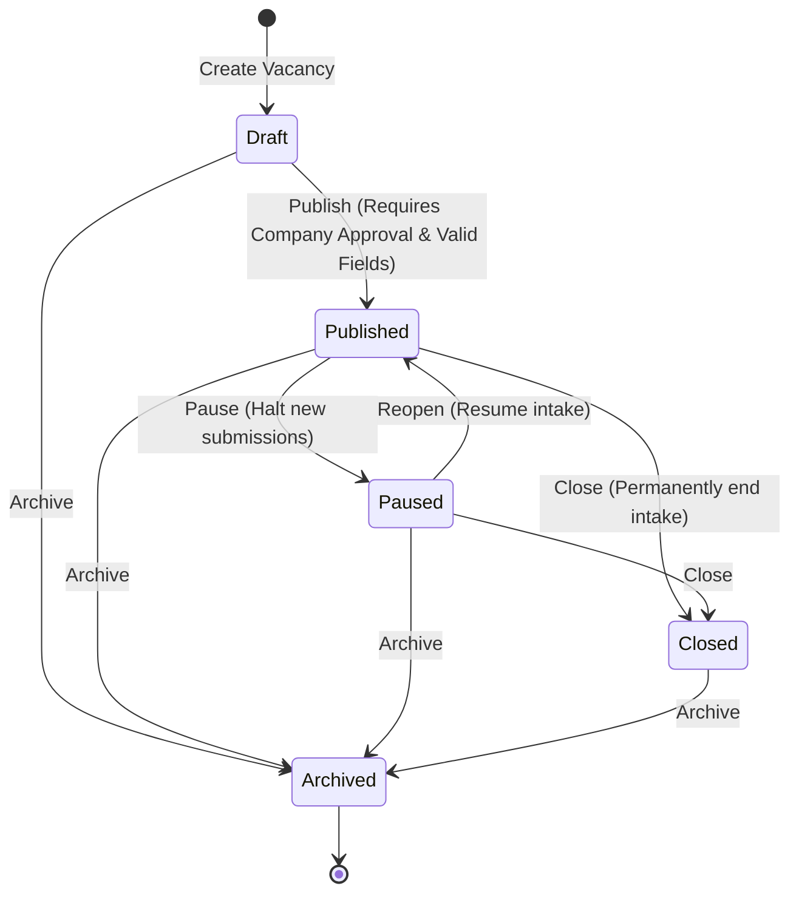

# HireSphere — Job Marketplace, Vacancy Management, and Recruitment Workflow Specification

**Phase:** Phase 3 — Recruitment Workflow Foundation  
**Status:** Implemented & Verified (Awaiting Manual SSMS Script Execution)  
**Authors:** Senior Full-Stack Engineering Team  

---

## 1. Executive Overview

HireSphere Phase 3 delivers the end-to-end recruitment marketplace and application lifecycle connecting candidates, verified employers, and platform governance through production-grade ASP.NET Core Web APIs and responsive React 19 interfaces.

This phase implements a deterministic, auditable recruiting workflow:
1. **Companies** author vacancies with structured qualification requirements, publish approved openings, review incoming applicant dossiers, and transition application stages while recording an immutable audit trail.
2. **Candidates** discover verified openings on the public marketplace using multifaceted filters, inspect transparent requirements, submit profile-first applications, track recruitment progress, and withdraw when necessary.
3. **Tenant Boundaries & Multi-Tenancy Rules** prevent cross-company leakage and ensure candidate identity is derived securely from authenticated JWT claims.

---

## 2. Vacancy Lifecycle & State Transitions

Vacancies follow a strict finite-state lifecycle enforced exclusively on the backend (`IJobService` / `JobService.cs`):



### Lifecycle Rules & Server-Side Enforcement

1. **Draft (`0`):**
   - Editable by authorized company users (`Owner`, `Recruiter`).
   - Completely invisible on the public marketplace and candidate search APIs.
   - Applications cannot be submitted against drafts.
2. **Published (`1`):**
   - Requires that the owning company has `CompanyApprovalStatus.Approved`. A company with status `PendingApproval` or `Suspended` receives `400 Bad Request` or `403 Forbidden`.
   - Requires all mandatory fields: Title, Summary, Description, Location, Category, and at least one structured requirement.
   - Visible to candidates on the public marketplace (`GET /api/jobs`).
   - Actively accepts candidate submissions until `expiresAtUtc` is reached.
3. **Paused (`2`):**
   - Temporarily halts new candidate submissions (`400 Bad Request` if an application attempt occurs).
   - Retains access for company recruiters to screen existing applications.
   - Can be reopened into `Published` if company eligibility remains valid.
4. **Closed (`3`):**
   - Permanently ends candidate application intake.
   - Existing applications and status histories remain fully preserved and reviewable.
   - Cannot transition back to `Published` or `Draft`.
5. **Archived (`4`):**
   - Soft-retired status for historical compliance.
   - Hidden from standard company active lists unless explicitly queried.
   - Referential integrity guarantees that no application or history records are deleted.

---

## 3. Structured Job Requirements Model

Unlike basic portals that bury qualifications in unstructured text blobs, HireSphere models requirements as first-class structured entities (`JobRequirement`):

| Property | Type | Description |
| :--- | :--- | :--- |
| `Id` | `Guid` | Primary key identifier. |
| `RequirementCategory` | `Enum` (int) | `Skill (0)`, `Experience (1)`, `Education (2)`, `Certification (3)`. |
| `RequirementType` | `Enum` (int) | `Mandatory (0)` vs `Preferred (1)`. |
| `RequirementText` | `nvarchar(500)` | Concrete qualification description (e.g., "5+ years C# / ASP.NET Core"). |
| `DisplayOrder` | `int` | Recruiter-specified ordering. |

### Domain Integrity Rules
- Every vacancy must have at least one structured requirement before publication.
- Recruiters can add, remove, and reorder requirements dynamically.
- When a published job is modified, requirements are preserved in the historical version snapshot.

---

## 4. Job-Description Versioning Architecture

When a published vacancy undergoes substantive edits (title, description, responsibilities, compensation, or structured requirements), HireSphere automatically generates an immutable version snapshot:

1. **Snapshot Table:** `JobDescriptionVersions` stores a full JSON payload (`SnapshotJson`) representing the vacancy state at that exact moment, along with `VersionNumber`, `ChangeSummary`, `CreatedByUserId`, and `CreatedAtUtc`.
2. **Active Version Tracking:** `JobPostings.ActiveVersionNumber` increments monotonically (`v1`, `v2`, ...).
3. **Historical Freeze:** When a candidate applies, `JobApplication.JobDescriptionVersionId` captures a foreign key reference to the exact version active at the time of submission.
4. **Deterministic Auditing:** Subsequent edits by employers never mutate or rewrite the historical criteria used to evaluate existing applicants.

---

## 5. Candidate Application Workflow & Duplicate Protection

### Submission Rules (`POST /api/jobs/{jobId}/apply`)
1. **Authentication & Identity Derivation:**
   - Endpoint requires `[Authorize(Roles = "Candidate")]`.
   - Candidate identity is derived directly from JWT claims (`sub` / `NameIdentifier`) mapped to `CandidateProfile.Id`. The request body cannot specify a candidate identifier.
2. **Vacancy Eligibility Checks:**
   - Job must exist and have status `JobPostingStatus.Published`.
   - Owning company must be in `CompanyApprovalStatus.Approved`.
   - If `ExpiresAtUtc` is specified, it must not be in the past.
3. **Duplicate Prevention:**
   - An application is rejected with `409 Conflict` if the candidate has an existing active application (status not `Withdrawn`) for the same vacancy.
   - Enforced both through service-level transactional checks and a filtered unique database index on `JobApplications(CandidateProfileId, JobPostingId)` where `CurrentStage <> 9`.
4. **Profile-First Submission:**
   - Candidate's verified profile data (headline, bio, experience, skills, social links) is packaged with the application.
   - An optional cover note (`candidateCoverNote`) can be supplied.
   - `CandidateDocumentId` is optional in Phase 3 (governed by SQL script 006), allowing candidates to apply before file storage workers are introduced in Phase 4.

---

## 6. Application Lifecycle & Recruiter Decision Pipeline

### Permitted Application Stages (`ApplicationStage` enum)

| Value | Stage Name | Description | Who Can Set |
| :---: | :--- | :--- | :--- |
| `0` | `Submitted` | Initial application received. | System (on apply) |
| `1` | `UnderReview` | Recruiter is screening profile & qualifications. | Recruiter / Owner |
| `2` | `Shortlisted` | Candidate qualified for next evaluation step. | Recruiter / Owner |
| `3` | `AssessmentPending` | WorkSim / assessment assigned (future Phase 5). | Recruiter / Owner |
| `4` | `AssessmentCompleted` | Candidate finished assessment. | System / Recruiter |
| `5` | `InterviewScheduled` | Interview invite dispatched. | Recruiter / Owner |
| `6` | `Offered` | Employment offer extended. | Recruiter / Owner |
| `7` | `Hired` | Candidate accepted offer and hired. | Recruiter / Owner |
| `8` | `Rejected` | Candidate not selected for opening. | Recruiter / Owner |
| `9` | `Withdrawn` | Candidate retracted their application. | Candidate (self-service) |

### Transition Invariants
- **Candidate Withdrawal:** Candidates can only withdraw applications that are not already `Hired`, `Rejected`, or `Withdrawn`. Candidates can never promote their own application to `Shortlisted`, `Offered`, or `Hired`.
- **Recruiter Scoping:** Recruiters can only transition applications for vacancies belonging to their authorized, approved company tenant.
- **Immutable Audit Trail:** Every stage update creates a corresponding record in `ApplicationStatusHistories` within an atomic EF Core transaction, recording `PreviousStage`, `NewStage`, `ChangedByUserId`, `ChangedByName`, `ReasonNote`, and `CreatedAtUtc`.

---

## 7. Tenant Isolation & Privacy Protections

1. **Zero Cross-Company Exposure:**
   - All company-scoped queries (`GET /api/companies/{companyId}/jobs`, `GET /api/companies/{companyId}/applications`) resolve active membership and role (`Owner`, `Recruiter`, `HiringManager`).
   - If a caller supplies an unauthorized `companyId`, the system yields `403 Forbidden` regardless of route parameters.
2. **Candidate Privacy:**
   - Candidates can only query `GET /api/candidate/applications` and `GET /api/candidate/applications/{id}` for records belonging to their authenticated `CandidateProfileId`.
   - Candidates never receive private internal recruiter notes (`CandidateNotes` or internal moderation tags).
   - Passwords, identity tokens, and unrelated documents are never exposed in application responses.

---

## 8. Complete API Endpoint Catalog

### Public Job Marketplace (`JobsController`)

| Method | Route | Description | Auth Required |
| :--- | :--- | :--- | :--- |
| `GET` | `/api/jobs` | Search & filter published vacancies with pagination. | None (Public) |
| `GET` | `/api/jobs/{id}` | Retrieve public job specifications and requirements. | None (Public) |
| `GET` | `/api/jobs/categories` | Retrieve list of active job categories. | None (Public) |

### Company Vacancy Management (`CompanyJobsController`)

| Method | Route | Description | Auth Required | Role / Policy |
| :--- | :--- | :--- | :--- | :--- |
| `GET` | `/api/companies/{companyId}/jobs` | List company vacancies with pagination and status filters. | Yes | `CompanyMember` (Owner, Recruiter, HM) |
| `GET` | `/api/companies/{companyId}/jobs/{jobId}` | Get detailed vacancy with structured requirements. | Yes | `CompanyMember` (Owner, Recruiter, HM) |
| `POST` | `/api/companies/{companyId}/jobs` | Create a new vacancy draft with requirements. | Yes | `CompanyMember` (Owner, Recruiter) |
| `PUT` | `/api/companies/{companyId}/jobs/{jobId}` | Update vacancy details and requirements. | Yes | `CompanyMember` (Owner, Recruiter) |
| `POST` | `/api/companies/{companyId}/jobs/{jobId}/publish` | Transition vacancy from Draft to Published. | Yes | `CompanyMember` (Owner, Recruiter) |
| `POST` | `/api/companies/{companyId}/jobs/{jobId}/pause` | Temporarily halt application intake. | Yes | `CompanyMember` (Owner, Recruiter) |
| `POST` | `/api/companies/{companyId}/jobs/{jobId}/reopen` | Reopen paused vacancy to Published. | Yes | `CompanyMember` (Owner, Recruiter) |
| `POST` | `/api/companies/{companyId}/jobs/{jobId}/close` | Permanently close vacancy intake. | Yes | `CompanyMember` (Owner, Recruiter) |
| `POST` | `/api/companies/{companyId}/jobs/{jobId}/archive` | Archive vacancy for compliance retention. | Yes | `CompanyMember` (Owner, Recruiter) |

### Candidate Applications (`CandidateApplicationsController`)

| Method | Route | Description | Auth Required | Role / Policy |
| :--- | :--- | :--- | :--- | :--- |
| `POST` | `/api/jobs/{jobId}/apply` | Submit profile-first application to an open vacancy. | Yes | `Candidate` |
| `GET` | `/api/candidate/applications` | List candidate's submitted applications. | Yes | `Candidate` |
| `GET` | `/api/candidate/applications/{id}` | Get application detail with status timeline. | Yes | `Candidate` |
| `POST` | `/api/candidate/applications/{id}/withdraw` | Withdraw active application. | Yes | `Candidate` |

### Company Applications Review (`CompanyApplicationsController`)

| Method | Route | Description | Auth Required | Role / Policy |
| :--- | :--- | :--- | :--- | :--- |
| `GET` | `/api/companies/{companyId}/applications` | Filter applicant pipeline by job, stage, search. | Yes | `CompanyMember` (Owner, Recruiter, HM) |
| `GET` | `/api/companies/{companyId}/applications/{id}` | Review candidate profile, cover note, stage timeline. | Yes | `CompanyMember` (Owner, Recruiter, HM) |
| `POST` | `/api/companies/{companyId}/applications/{id}/stage` | Advance or reject application stage with notes. | Yes | `CompanyMember` (Owner, Recruiter) |

---

## 9. SQL Server Schema Prerequisites (Manual SSMS Execution)

In compliance with the **mandatory database rule**, no schema changes or seed scripts are executed automatically. All scripts are idempotently prepared in `database/`:

1. **`002_CreateRecruitmentAndApplicationsSchema.sql`**:
   - Creates `JobCategories`, `JobPostings`, `JobRequirements`, `JobDescriptionVersions`, `CandidateDocuments`, `JobApplications`, `ApplicationStatusHistories`, `CandidateNotes`.
   - Updated Line 153 to make `CandidateDocumentId NULL` for profile-first applications.
2. **`006_MakeCandidateDocumentOptionalInApplications.sql`**:
   - For users who ran script 002 previously, alters `JobApplications.CandidateDocumentId` to `NULL`.
3. **`002_SeedJobCategories.sql`**:
   - Seeds 8 standard job categories (`Software Engineering`, `Cloud & DevOps`, `Data & AI`, `Cybersecurity`, `Product Management`, `Design & Creative`, `Quality Assurance`, `Technical Support`).

---

## 10. Automated Test Results

- **Backend Unit Tests:** 37 of 37 passed (`JobServiceTests`, `JobMarketplaceServiceTests`, `ApplicationServiceTests`, `AuthenticationTests`, `AuthorizationTests`).
  ```bash
  cd backend
  dotnet test --no-restore
  # Result: Passed! Failed: 0, Passed: 37, Skipped: 0, Total: 37
  ```
- **Frontend Build Validation:** Clean production compilation (`tsc -b && vite build`) in 498ms with 0 errors.
  ```bash
  cd frontend
  npm run build
  # Result: Exit Code 0, dist bundle generated cleanly
  ```

---

## 11. Known Limitations & Scope Discipline

- **CV File Parsing & Worker Queue:** Deferred to Phase 4. Applications currently submit candidate profiles directly.
- **WorkSim Interactive Simulations:** Deferred to Phase 5. Application stage `AssessmentPending` exists in the domain model but cannot trigger a live simulation yet.
- **Payment & Subscriptions:** Deferred to Phase 7. Job publishing does not require Stripe billing credits during Phase 3.
