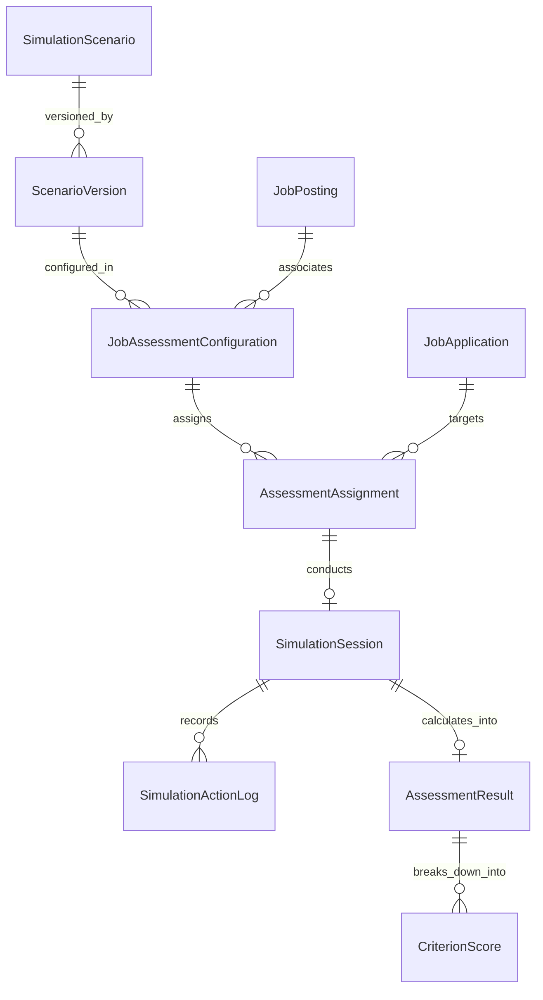

# HireSphere — WorkSim Assessment Engine Architecture & Data Model

**Document ID:** `HS-SIM-03`  
**Version:** 1.0  
**Phase:** Phase 1 WorkSim Specification  
**Status:** Approved Simulation Model  

---

## 1. Engine Philosophy: Generic, Data-Driven State Machine

WorkSim is an extensible, **server-authoritative simulation runtime**. Rather than creating custom tables for every job scenario, the WorkSim engine uses a generalized state-machine data model that treats scenarios as **versioned definitions executed by a common C# runtime**.

```
┌────────────────────────────────────────────────────────────────────────────────────────┐
│                                 SCENARIO DEFINITION                                    │
│   • Initial State Vector (Variables, Metrics, Clues, Resource Clocks)                  │
│   • Investigation Tool Catalog (Logs, Telemetry, Invoices, Orders, Git Commits)        │
│   • Permitted Action Catalog & State Transition Rules                                  │
│   • Immutable Rubric Version (Criteria, Formulas, Deductions, Evidence Hooks)          │
└───────────────────────────────────────────┬────────────────────────────────────────────┘
                                            │ Instantiated As
                                            ▼
┌────────────────────────────────────────────────────────────────────────────────────────┐
│                              INTERACTIVE SESSION RUNTIME                               │
│  Candidate Browser                    Backend Controller / State Machine               │
│  ─────────────────                    ──────────────────────────────────               │
│  1. Render UI State       ◄────────   Return Sanitized State Vector                    │
│  2. Dispatch Action       ────────►   Validate: Action Legal? Within Time Window?      │
│                                       Execute State Transition & Update Vector         │
│                                       Append to Append-Only SimulationActionLogs       │
│  3. Final Submit          ────────►   Evaluate Action Log against Rubric Version       │
│                                       Calculate Criterion Scores & Traceable Evidence  │
└────────────────────────────────────────────────────────────────────────────────────────┘
```

---

## 2. Relational Schema Architecture

The WorkSim relational model spans seven tightly bounded tables:



### 2.1 Table Contracts

1. **`SimulationScenarios`:** The catalog template.
   * `Id UNIQUEIDENTIFIER PK DEFAULT NEWSEQUENTIALID()`
   * `Title NVARCHAR(200) NOT NULL` (e.g., "Software Engineering: Checkout Outage")
   * `Category NVARCHAR(100) NOT NULL` (e.g., "Software Engineering", "Finance", "Operations")
   * `Description NVARCHAR(MAX) NOT NULL`
   * `EstimatedDurationMinutes INT NOT NULL`
   * `IsActive BIT NOT NULL DEFAULT 1`

2. **`ScenarioVersions`:** Immutable snapshot of definition and rubric.
   * `Id UNIQUEIDENTIFIER PK DEFAULT NEWSEQUENTIALID()`
   * `SimulationScenarioId UNIQUEIDENTIFIER NOT NULL FK -> SimulationScenarios(Id)`
   * `VersionNumber INT NOT NULL`
   * `DefinitionJson NVARCHAR(MAX) NOT NULL` (State vector, tools, transitions)
   * `RubricJson NVARCHAR(MAX) NOT NULL` (Scoring rules, criteria, weights)
   * `CreatedAtUtc DATETIMEOFFSET NOT NULL DEFAULT SYSDATETIMEOFFSET()`
   * *Rule:* Once an assessment session references a version, that version is permanently read-only.

3. **`JobAssessmentConfigurations`:** Employer's policy for a job vacancy.
   * `Id UNIQUEIDENTIFIER PK DEFAULT NEWSEQUENTIALID()`
   * `CompanyId UNIQUEIDENTIFIER NOT NULL FK -> Companies(Id)`
   * `JobPostingId UNIQUEIDENTIFIER NOT NULL FK -> JobPostings(Id)`
   * `ScenarioVersionId UNIQUEIDENTIFIER NOT NULL FK -> ScenarioVersions(Id)`
   * `IsRequired BIT NOT NULL DEFAULT 1` (Required vs Optional)
   * `MaxAllowedAttempts INT NOT NULL DEFAULT 1`
   * `DeadlineDaysAfterAssignment INT NOT NULL DEFAULT 7`

4. **`AssessmentAssignments`:** Candidate's assessment ticket.
   * `Id UNIQUEIDENTIFIER PK DEFAULT NEWSEQUENTIALID()`
   * `CompanyId UNIQUEIDENTIFIER NOT NULL FK -> Companies(Id)`
   * `JobApplicationId UNIQUEIDENTIFIER NOT NULL FK -> JobApplications(Id)`
   * `JobAssessmentConfigurationId UNIQUEIDENTIFIER NOT NULL FK -> JobAssessmentConfigurations(Id)`
   * `CandidateProfileId UNIQUEIDENTIFIER NOT NULL FK -> CandidateProfiles(Id)`
   * `DeadlineUtc DATETIMEOFFSET NOT NULL`
   * `Status INT NOT NULL DEFAULT 0` (0: Assigned, 1: InProgress, 2: Completed, 3: Expired)

5. **`SimulationSessions`:** Active game runtime instance.
   * `Id UNIQUEIDENTIFIER PK DEFAULT NEWSEQUENTIALID()`
   * `AssessmentAssignmentId UNIQUEIDENTIFIER NOT NULL FK -> AssessmentAssignments(Id)`
   * `CandidateProfileId UNIQUEIDENTIFIER NOT NULL FK -> CandidateProfiles(Id)`
   * `ScenarioVersionId UNIQUEIDENTIFIER NOT NULL FK -> ScenarioVersions(Id)`
   * `CurrentStateVectorJson NVARCHAR(MAX) NOT NULL` (Live game variables)
   * `Status INT NOT NULL DEFAULT 0` (0: Active, 1: Submitted, 2: TimedOut, 3: Aborted)
   * `StartedAtUtc DATETIMEOFFSET NOT NULL DEFAULT SYSDATETIMEOFFSET()`
   * `ExpiresAtUtc DATETIMEOFFSET NOT NULL`
   * `SubmittedAtUtc DATETIMEOFFSET NULL`
   * `TotalActionsTaken INT NOT NULL DEFAULT 0`
   * `RowVersion ROWVERSION NOT NULL`

6. **`SimulationActionLogs`:** Immutable append-only audit log of candidate behavior.
   * `Id UNIQUEIDENTIFIER PK DEFAULT NEWSEQUENTIALID()`
   * `SimulationSessionId UNIQUEIDENTIFIER NOT NULL FK -> SimulationSessions(Id)`
   * `SequenceNumber INT NOT NULL`
   * `ActionType NVARCHAR(100) NOT NULL` (e.g., `InspectLogs`, `QueryTelemetry`, `DeployRollback`)
   * `ActionPayloadJson NVARCHAR(MAX) NOT NULL`
   * `CandidateRationale NVARCHAR(1000) NULL`
   * `ElapsedMillisecondsFromStart BIGINT NOT NULL`
   * `TimestampUtc DATETIMEOFFSET NOT NULL DEFAULT SYSDATETIMEOFFSET()`

7. **`AssessmentResults`:** Server-authoritative outcome record.
   * `Id UNIQUEIDENTIFIER PK DEFAULT NEWSEQUENTIALID()`
   * `SimulationSessionId UNIQUEIDENTIFIER NOT NULL FK -> SimulationSessions(Id)` (Unique)
   * `ScenarioVersionId UNIQUEIDENTIFIER NOT NULL FK -> ScenarioVersions(Id)`
   * `TotalScore DECIMAL(5,2) NOT NULL` (0.00 to 100.00)
   * `EvaluationSummary NVARCHAR(MAX) NOT NULL`
   * `CandidateFeedback NVARCHAR(MAX) NOT NULL`
   * `EvaluatedAtUtc DATETIMEOFFSET NOT NULL DEFAULT SYSDATETIMEOFFSET()`

8. **`CriterionScores`:** Itemized competency breakdown.
   * `Id UNIQUEIDENTIFIER PK DEFAULT NEWSEQUENTIALID()`
   * `AssessmentResultId UNIQUEIDENTIFIER NOT NULL FK -> AssessmentResults(Id)`
   * `CriterionName NVARCHAR(100) NOT NULL`
   * `Score DECIMAL(5,2) NOT NULL`
   * `MaxScore DECIMAL(5,2) NOT NULL`
   * `SupportingEvidenceJson NVARCHAR(MAX) NOT NULL` (Links sequence numbers & timestamps)

---

## 3. Session Lifecycle & Resumption Protocol

```
 [ Assigned ] ──► [ InProgress ] ──► [ Active Session ] ──► [ Submitted ] ──► [ Evaluated ]
       │                 │                     │                     ▲
       ▼                 ▼                     ▼                     │
   [ Expired ]       [ Interrupted ]      [ TimedOut ] ──────────────┘
                         │
                         ▼ (Token + Assignment Reconnect)
                     [ Resumed ]
```

1. **Session Resumption & Anti-Tamper:** If a candidate closes their browser, experiences network drops, or reloads the tab:
   * The candidate makes a `POST /api/simulations/sessions/{id}/resume` request with their authentication token.
   * The backend validates that `Status == Active` and `DateTimeOffset.UtcNow < ExpiresAtUtc`.
   * The backend returns the authoritative `CurrentStateVectorJson` and action sequence count.
   * The client restores the exact workspace state. The session clock **never pauses** during interruptions, preventing candidates from artificially extending their investigation window.
2. **Deterministic Auto-Submit on Timeout:** If the session expiration time passes without a formal candidate submission:
   * Any subsequent action request transitions the session to `Status = TimedOut`.
   * A background worker or the final action handler executes the rubric evaluation against all actions taken prior to `ExpiresAtUtc`.
3. **Optimistic Concurrency:** The `RowVersion` column on `SimulationSessions` prevents race conditions from concurrent browser tabs attempting conflicting action dispatches.

---

## 4. Scenario JSON Payloads: 3 Exemplar Scenarios

### Exemplar 1: Software Engineering — "The Midnight Checkout Outage"
```json
{
  "scenarioId": "SWE-001",
  "version": 1,
  "title": "The Midnight Checkout Outage",
  "role": "On-Call Reliability Engineer",
  "durationMinutes": 30,
  "initialState": {
    "systemHealth": "Critical",
    "errorRatePercentage": 45.2,
    "p99LatencySeconds": 12.4,
    "activeOutageMinutes": 15,
    "toolsUnlocked": ["GrafanaTelemetry", "ElasticsearchLogs", "GitDeploymentDiff"],
    "recoveryStatus": "Unresolved"
  },
  "actionCatalog": [
    { "type": "InspectTelemetry", "costMinutes": 2, "target": "DatabaseConnectionPool" },
    { "type": "InspectTelemetry", "costMinutes": 2, "target": "PaymentGatewayService" },
    { "type": "QueryLogs", "costMinutes": 3, "query": "status:500 service:checkout" },
    { "type": "ReviewGitDiff", "costMinutes": 4, "commit": "v2.4.1" },
    { "type": "ExecuteMitigation", "costMinutes": 5, "action": "RestartPods" },
    { "type": "ExecuteMitigation", "costMinutes": 6, "action": "RollbackDeployment" },
    { "type": "VerifyRecovery", "costMinutes": 2, "target": "SyntheticCheckout" }
  ],
  "rubric": {
    "criteria": [
      {
        "name": "Investigation Quality",
        "weight": 0.25,
        "rules": [
          { "actionRequired": "QueryLogs", "minCount": 1, "points": 50 },
          { "actionRequired": "ReviewGitDiff", "minCount": 1, "points": 50 }
        ]
      },
      {
        "name": "Root-Cause Diagnostics",
        "weight": 0.35,
        "rules": [
          { "identifiedCause": "PaymentGatewayAdapterTimeoutInV2.4.1", "points": 100 }
        ]
      },
      {
        "name": "Mitigation Decision",
        "weight": 0.25,
        "rules": [
          { "action": "RollbackDeployment", "points": 100 },
          { "action": "RestartPods", "penalty": -20 }
        ]
      },
      {
        "name": "Recovery Verification",
        "weight": 0.15,
        "rules": [
          { "actionRequired": "VerifyRecovery", "points": 100 }
        ]
      }
    ]
  }
}
```

### Exemplar 2: Finance — "Cash Flow Crunch"
```json
{
  "scenarioId": "FIN-001",
  "version": 1,
  "title": "Cash Flow Crunch: 30-Day Liquidity Emergency",
  "role": "Finance Operations Manager",
  "durationMinutes": 35,
  "initialState": {
    "operatingCashOnHand": 125000.00,
    "upcomingObligations30Days": 380000.00,
    "accountsReceivableOutstanding": 410000.00,
    "revolvingCreditLimit": 150000.00,
    "currentCreditDrawn": 100000.00,
    "statutoryPayrollDueDays": 7,
    "statutoryPayrollAmount": 140000.00
  },
  "actionCatalog": [
    { "type": "InspectReport", "target": "AccountsPayableAging" },
    { "type": "InspectReport", "target": "AccountsReceivableOverdue" },
    { "type": "InspectCovenants", "target": "BankCreditFacility" },
    { "type": "NegotiateTerms", "vendor": "RawMaterialsSupplier", "requestDays": 15 },
    { "type": "OfferEarlyDiscount", "customer": "AnchorClient", "discountRate": 0.02 },
    { "type": "AuthorizePayment", "obligation": "Payroll" },
    { "type": "AuthorizePayment", "obligation": "VendorInvoices" }
  ],
  "rubric": {
    "criteria": [
      { "name": "Statutory Obligation Priority", "weight": 0.30, "rules": [{ "paidObligation": "Payroll", "withinDays": 7, "points": 100 }] },
      { "name": "Working Capital Optimization", "weight": 0.35, "rules": [{ "negotiatedVendorTerms": true, "points": 50 }, { "acceleratedReceivables": true, "points": 50 }] },
      { "name": "Credit Covenant Adherence", "weight": 0.20, "rules": [{ "covenantBreached": false, "points": 100 }] },
      { "name": "Cash Buffer Preservation", "weight": 0.15, "rules": [{ "minCashMaintained": 25000.00, "points": 100 }] }
    ]
  }
}
```

### Exemplar 3: E-Commerce Operations — "Black Friday Logistics Breakdown"
```json
{
  "scenarioId": "OPS-001",
  "version": 1,
  "title": "Black Friday Logistics Breakdown",
  "role": "Head of Fulfillment & Logistics",
  "durationMinutes": 30,
  "initialState": {
    "distributionCenterStatus": { "HubCentral": "ConveyorFailure", "HubEast": "Normal", "HubWest": "Normal" },
    "pendingOrdersBacklog": 18500,
    "expressSlaDeadlineHours": 12,
    "carrierWeatherDisruption": "WinterStormMidwest",
    "customerComplaintsPerHour": 420
  },
  "actionCatalog": [
    { "type": "InspectWarehouseTelemetry", "facility": "HubCentral" },
    { "type": "QueryCarrierStatus", "carrier": "NationalExpress" },
    { "type": "RerouteFulfillment", "from": "HubCentral", "to": "HubEast", "maxOrders": 8000 },
    { "type": "PrioritizeFulfillmentBatch", "batchType": "ExpressSLAs" },
    { "type": "DispatchEmergencyCourier", "facility": "HubCentral", "surchargePerOrder": 4.50 },
    { "type": "SendCustomerProactiveAlert", "messageType": "WeatherDelayWithStoreCredit" }
  ],
  "rubric": {
    "criteria": [
      { "name": "SLA Risk Mitigation", "weight": 0.35, "rules": [{ "prioritizedExpress": true, "points": 100 }] },
      { "name": "Network Load Balancing", "weight": 0.30, "rules": [{ "reroutedOrders": true, "destination": "HubEast", "points": 100 }] },
      { "name": "Customer Communication", "weight": 0.20, "rules": [{ "proactiveNotificationSent": true, "points": 100 }] },
      { "name": "Cost Control Under Duress", "weight": 0.15, "rules": [{ "excessCourierSurchargesBelow": 25000.00, "points": 100 }] }
    ]
  }
}
```

---

## 5. Explainability & Responsible Assessment Guardrails

1. **Evidence Traceability:** The company evaluator UI displays a direct audit trail linking every awarded point to concrete candidate action logs (e.g., *“Criterion: Investigation Quality (90/100) — Justified by Action #3: QueryLogs (00:04:12) and Action #5: ReviewGitDiff (00:08:35)”*).
2. **Prohibition of Automated Rejections:** The system UI explicitly labels WorkSim results as **“Structured Evaluator Decision Support”**. The platform API prohibits automated rejection triggers tied solely to WorkSim scores.
3. **Accessibility Accommodations:**
   * Accommodations can be enabled at the `AssessmentAssignments` level (e.g., `TimeExtensionMultiplier: 1.5` or `HighContrastAccessibleTheme: true`).
   * Full keyboard navigation for action catalog inspection and timeline exploration.
