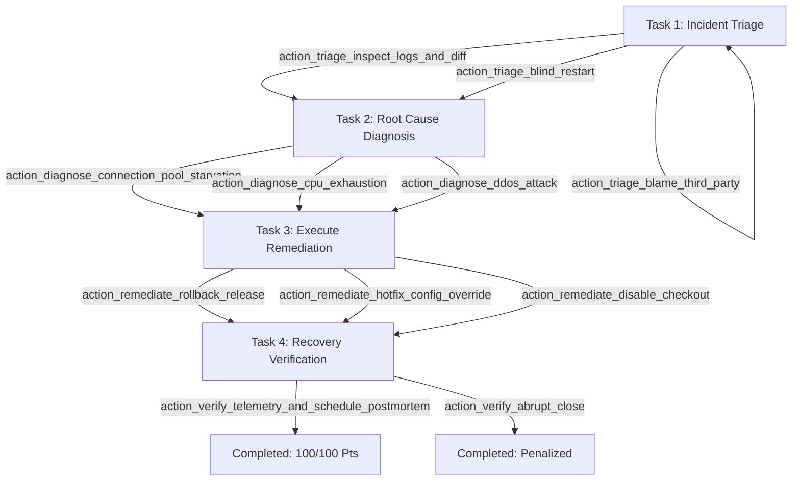

# WorkSim™ Reusable Interactive Job Simulation Engine

**Specification ID:** `HS-SPEC-05`  
**Architecture Layer:** HireSphere Domain & Application Engine  
**Status:** Production Ready / Implemented  
**Version:** 1.0.0  

---

## 1. Executive Summary & Vision

Traditional technical recruitment relies heavily on multiple-choice quizzes (MCQs) and detached algorithmic challenges. These fail to reflect how engineers, financial analysts, or operations managers solve messy, ambiguous, real-world problems.

**WorkSim™** is HireSphere's reusable interactive job simulation engine. It immerses candidates in realistic, fictional workplace situations where they must:
* Review ambiguous problem descriptions and high-urgency alerts.
* Inspect diverse, realistic evidence items (APM metrics, pod error logs, Git diffs, deployment history, partner status dashboards).
* Prioritize diagnostic steps under operational trade-offs and limited investigation cycles.
* Formulate and document written operational rationales for their consequential choices.
* Execute remediation strategies with branching consequences (e.g. rollbacks, config overrides, feature toggles).
* Verify recovery telemetry and schedule post-incident reviews.
* Receive transparent, explainable feedback scored against versioned deterministic rubrics.

Crucially, **WorkSim is a domain-agnostic engine**. The same state machine, event ledger, and rubric scoring services support software engineering incident response, finance cash-flow triage, customer support escalations, and supply chain logistics without modifying backend code.

---

## 2. Core Architecture & Component Responsibilities

The WorkSim engine is built following Clean Architecture principles within HireSphere's ASP.NET Core modular monolith:

```
┌────────────────────────────────────────────────────────────────────────┐
│                        Candidate / Recruiter UI                        │
│   CandidateSimulations.tsx   SimulationWorkspace.tsx   SimulationResult │
└────────────────────────────────────┬───────────────────────────────────┘
                                     │ HTTPS / JWT
┌────────────────────────────────────▼───────────────────────────────────┐
│                        HireSphere.Api Controllers                      │
│   SimulationsController.cs        CompanyAssessmentsController.cs      │
└────────────────────────────────────┬───────────────────────────────────┘
                                     │
┌────────────────────────────────────▼───────────────────────────────────┐
│                     HireSphere.Application Services                    │
│  ┌────────────────────────┐  ┌───────────────────────┐  ┌────────────┐ │
│  │ WorkSimRuntimeService  │  │ WorkSimScoringService │  │ Management │ │
│  └───────────┬────────────┘  └───────────┬───────────┘  └──────┬─────┘ │
└──────────────┼───────────────────────────┼─────────────────────┼───────┘
               │                           │                     │
┌──────────────▼───────────────────────────▼─────────────────────▼───────┐
│              HireSphere.Domain & Infrastructure Persistence             │
│   SimulationScenarios      ScenarioVersions     AssessmentAssignments  │
│   SimulationSessions       SimulationActionLogs AssessmentResults      │
└────────────────────────────────────────────────────────────────────────┘
```

### Separated Responsibilities

1. **Scenario Definition & Versioning:** Scenarios are modeled as immutable, versioned declarative specifications (`ScenarioDefinition` and `SimulationRubricDefinition`). Once candidates take attempts against Version 1, Version 1 is immutable. Any edits produce Version 2+.
2. **Assignment Engine:** Recruiters configure simulation requirements per job vacancy (`JobAssessmentConfiguration`). When a candidate applies, HireSphere automatically creates an `AssessmentAssignment` with deadlines and attempt limits.
3. **Authoritative Runtime (`WorkSimRuntimeService`):** Evaluates candidate actions, verifies task preconditions, updates state vectors, unlocks evidence, and enforces sequential integrity. The server is authoritative—client state or scores are never trusted.
4. **Sanitized Projection:** Candidates receive only their current task, unlocked evidence, and available actions. Future branching tasks, terminal conditions, and scoring rubrics are completely hidden from candidate API payloads.
5. **Action Event Ledger:** Every candidate decision is logged to `SimulationActionLogs` with server timestamps, elapsed milliseconds, sequence numbers, and candidate rationales.
6. **Deterministic Scoring (`WorkSimScoringService`):** When terminal tasks are reached, the session is evaluated against the versioned rubric. Criteria evaluate evidence inspection, diagnosis accuracy, blast-radius mitigation, and post-incident verification.
7. **Ethical Decision Support:** WorkSim results are human-review evidence for hiring teams, never automated rejections.

---

## 3. Working Software Engineering Incident Response Scenario

HireSphere ships with an end-to-end working software engineering scenario:  
**"Payment Gateway Latency Spike & 504 Gateway Timeouts"** (`swe_incident_payment_gateway`).

### Incident Context
At 14:15 UTC, the HireSphere Core Checkout and Payment Gateway triggered critical P1 pager alerts. Customer checkout requests are timing out with HTTP 504 Gateway Timeout. Error rates have surged from 0.02% to 18.4%, and p99 latency has jumped to 12.8 seconds. Release v2.14.0 was deployed to production 5 minutes prior to the alert at 14:10 UTC.

### Task Flow & Branching



### Realistic Evidence Items
1. **`telemetry_latency_alert` (APM Dashboard):** Baseline vs post-deployment throughput, p50/p95/p99 latencies, HTTP 504 rates, and connection pool utilization.
2. **`deployment_timeline` (CI/CD History):** Details release v2.14.0 (commit `8f9b1c2`, author Alex Vance, PR #482 "Update payment retry strategy & connection pool tuning").
3. **`error_log_excerpt` (Pod Application Logs):** Shows `Npgsql.ConnectorPool` timeout: `MaxPoolSize=20`, 20 active connections, 142 threads blocked in queue, and aggressive 5-retry loops inside `TransactionScope`.
4. **`git_diff_pr482` (PR Git Diff):** Shows `MaxPoolSize` was dropped from 100 to 20 to "save DB memory" while wrapping retry loops inside open transactions.
5. **`payment_partner_status` (Stripe/Adyen Status):** Third-party partner reports normal latency (135ms), proving issue is internal.
6. **`post_remediation_telemetry` (Post-Remediation Verification):** Telemetry after rollback or config override showing latency dropping to 45ms and 0.00% timeouts.

### 4 Rubric Criteria (100 Total Points)
1. **Triage Prioritization & Evidence Gathering (25 pts):** Rewards inspecting logs and diffs before mutating infrastructure; rewards written rationale; penalizes premature blind restarts.
2. **Technical Diagnosis & Evidence Interpretation (25 pts):** Rewards identifying PR #482 connection pool starvation and retry loops; penalizes speculative CPU saturation claims.
3. **Remediation Strategy & Blast-Radius Management (30 pts):** Rewards immediate rollback to v2.13.9 (fastest MTTR) or runtime ConfigMap override; penalizes disabling checkout.
4. **Recovery Verification & Incident Wrap-up (20 pts):** Rewards verifying latency telemetry for 15 minutes and scheduling a blameless retrospective; penalizes closing tickets unmonitored.

---

## 4. Multi-Domain Extensibility (Authoring New Scenarios)

Because the engine is declarative, creating a Finance or Customer Experience scenario requires **zero C# code changes**.

### Example: Finance Cash-Flow Triage
```json
{
  "ScenarioKey": "fin_liquidity_variance_q3",
  "Title": "Finance: Q3 Working Capital Shortfall & Payables Prioritization",
  "Category": "Finance",
  "EstimatedDurationMinutes": 30,
  "InitialState": {
    "cash_balance": "$142,000",
    "payables_due_7_days": "$380,000",
    "revolving_credit_available": "$150,000",
    "liquidity_risk_status": "Severe Deficit"
  },
  "EvidenceItems": [
    { "EvidenceKey": "aging_payables_schedule", "Title": "A/P Aging Schedule", "Category": "Accounting" },
    { "EvidenceKey": "expected_customer_receivables", "Title": "A/R Collections Forecast", "Category": "Treasury" }
  ],
  "Tasks": [
    {
      "TaskKey": "task_1_reconcile_variance",
      "Title": "Task 1: Identify Liquidity Gap",
      "AvailableActions": [
        { "ActionKey": "action_audit_vendor_contracts", "Title": "Audit Critical Vendor Terms" }
      ]
    }
  ]
}
```

The runtime service loads this JSON, validates candidate actions, applies state changes (e.g. `cash_balance: "$292,000"`), and evaluates against the finance rubric.

---

## 5. Security & Tenant Isolation Guarantees

| Security Requirement | Implementation in WorkSim Engine |
| :--- | :--- |
| **Candidate Session Boundary** | `SimulationSessions` validated against `CandidateProfile.UserId == currentUserId`. Submitting an action to another candidate's session returns `403 Forbidden`. |
| **Recruiter Review Boundary** | Recruiters can only access results for candidates who submitted applications to their company's jobs (`CompanyMember.MembershipStatus == Active`). |
| **Hidden Answer Protection** | `CandidateSimulationRuntimeStateDto` only transmits current task instructions, available action keys, and unlocked evidence. Rubric JSON and future tasks are never sent to browser. |
| **Authoritative State Transitions** | The server evaluates transitions, applies mutations, increments action counters, and evaluates scoring. No client score overrides exist. |
| **Idempotent Scoring** | Re-evaluating a completed session returns the existing stored `AssessmentResult`. Duplicate scoring records are prevented by unique constraints. |
| **Time Limits & Deadlines** | `ExpiresAtUtc` is checked on every action. Expired sessions automatically transition to `TimedOut` and reject further mutations. |

---

## 6. Manual SQL Execution Runbook (SSMS)

To deploy WorkSim to an existing SQL Server instance:

1. **Open SSMS** and connect to your database server.
2. Select target database: `USE HireSphereDb; GO`.
3. Open and execute: `database/scripts/004_CreateWorkSimAssessmentSchema.sql`.
   * Verifies/creates 8 tables with foreign keys and unique constraints.
4. Open and execute: `database/scripts/008_SeedWorkSimIncidentScenario.sql`.
   * Inserts the default SWE Incident Response scenario and version 1.
5. Verify installation:
   ```sql
   SELECT Title, Category, EstimatedDurationMinutes FROM dbo.SimulationScenarios;
   SELECT v.VersionNumber, s.Title FROM dbo.ScenarioVersions v JOIN dbo.SimulationScenarios s ON s.Id = v.SimulationScenarioId;
   ```
